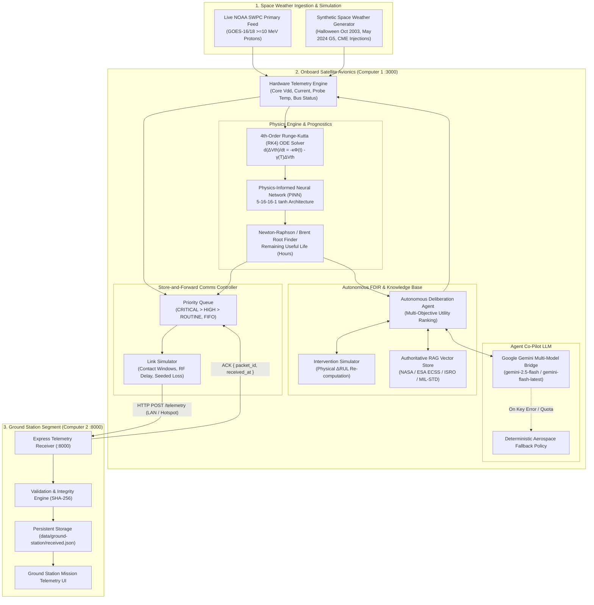

# Satellite Reliability AI: System Architecture & Operational Workflow

An engineering guide to the **Satellite Reliability AI** platform: Physics-Informed Neural Networks (PINN), Remaining Useful Life (RUL) estimation, autonomous Fault Detection, Isolation, and Recovery (FDIR), aerospace RAG compliance, and real-time satellite-to-ground telemetry communications.

---

## 1. Executive Overview

**Satellite Reliability AI** is a dual-system, closed-loop aerospace reliability testbed. It simulates a **550 km Sun-Synchronous Low Earth Orbit (LEO)** spacecraft (**Sat - M1**) equipped with commercial-off-the-shelf (COTS) deep-submicron CMOS payload compute elements subjected to space weather (solar proton events / Coronal Mass Ejections).

The platform combines:
1. **Physical Degradation Modeling:** Semi-empirical differential equations governing gate-oxide charge trapping and Arrhenius thermal annealing.
2. **Scientific Machine Learning (SciML / PINN):** A Physics-Informed Neural Network (5–16–16–1 MLP) balancing numerical simulation fit with ODE physics loss.
3. **Prognostics & Health Management (PHM / RUL):** Newton-Raphson and Brent-bracketed solvers computing Remaining Useful Life against parametric failure limits ($\Delta V_{\text{th}} = -1.50\,\text{V}$).
4. **Autonomous Cognitive FDIR Agent:** A ReAct loop integrating live telemetry, deterministic safety interlocks, and a Retrieval-Augmented Generation (RAG) vector store grounded in **NASA-HDBK-4002A**, **ECSS-Q-ST-60-15C**, **ISRO-SP-71**, and **MIL-STD-883K**.
5. **Conversational Multi-Model LLM Agent Co-Pilot:** Real-time mission reasoning powered by Google Gemini (with deterministic offline fallback).
6. **Distributed Satellite-to-Ground Comms:** Priority store-and-forward queueing with link simulation (packet loss, RF propagation delay, contact windows) transmitting versioned JSON telemetry across LAN/Hotspot to an independent Ground Station receiver.

---

## 2. High-Level System Architecture



---

## 3. Core Physics & Prognostics Modeling

### 3.1 Governing Differential Equation
Under energetic proton bombardment ($E > 10\,\text{MeV}$), hole-electron pairs are generated in the CMOS gate silicon dioxide ($\text{SiO}_2$). Electrons evacuate rapidly, while holes get trapped in deep oxide traps, causing negative threshold voltage shifts ($\Delta V_{\text{th}}$):

$$\frac{d(\Delta V_{\text{th}})}{dt} = -\kappa \cdot \Phi(t) - \gamma(T) \cdot \Delta V_{\text{th}}$$

Where:
- $\Phi(t)$: Proton flux in particles per $\text{cm}^2 \cdot \text{s} \cdot \text{sr}$ ($\text{pfu}$).
- $\kappa$: Trapping cross-section sensitivity factor ($0.0000622\,\text{V} / (\text{pfu} \cdot \text{h})$).
- $\gamma(T)$: Arrhenius-governed thermal annealing rate:
  $$\gamma(T) = \gamma_0 \cdot \exp\left(-\frac{E_a}{k_B \cdot (T + 273.15)}\right)$$
  With attempt frequency $\gamma_0 = 0.042\,\text{h}^{-1}$, activation energy $E_a = 0.175\,\text{eV}$, and Boltzmann constant $k_B = 8.617 \times 10^{-5}\,\text{eV}/\text{K}$.

### 3.2 Physics-Informed Neural Network (PINN)
- **Architecture:** $5 \rightarrow 16 \rightarrow 16 \rightarrow 1$ Multi-Layer Perceptron (MLP) with $\tanh$ activations.
- **Inputs:** Normalized time $t$, proton flux $\Phi(t)$, operating temperature $T$, supply voltage $V_{\text{dd}}$, and clock duty cycle $D$.
- **Output:** Transistor threshold shift $\Delta V_{\text{th}}(t)$.
- **Composite Loss Function:**
  $$\mathcal{L}_{\text{total}} = \mathcal{L}_{\text{data}} + \lambda_{\text{phys}} \mathcal{L}_{\text{physics}} + \mathcal{L}_{\text{init}}$$
  $$\mathcal{L}_{\text{physics}} = \frac{1}{N} \sum_{i=1}^{N} \left( \frac{\partial \widehat{\Delta V_{\text{th}}}}{\partial t}\Big|_i - \mathcal{F}_{\text{ODE}}(t_i, \Phi_i, T_i, \widehat{\Delta V_{\text{th}, i}}) \right)^2$$
  This formulation guarantees that the neural prediction obeys semiconductor physics even outside empirical observation windows.

### 3.3 RUL Root Finding
Remaining Useful Life is the earliest future time $t_{\text{RUL}}$ where degradation hits the critical failure boundary:

$$\Delta V_{\text{th}}(t_0 + t_{\text{RUL}}) = V_{\text{threshold}} \quad (-1.50\,\text{V})$$

The engine employs high-precision **Newton-Raphson iteration** accelerated by **Brent bracketed search** when non-monotonic derivatives occur.

---

## 4. Operational Workflow & Incident Lifecycle

The application operates as an event-driven closed loop across 5 operational phases:

```mermaid
sequenceDiagram
    autonumber
    participant Obs as Space Weather / Operator
    participant OBC as Spacecraft Avionics (Node Sat-M1)
    participant PINN as PINN & RUL Engine
    participant Agent as Autonomous FDIR Agent
    participant KB as Aerospace Knowledge Base
    participant Comms as Onboard Comms Queue
    participant GS as Ground Station (Node GS-Primary)

    Note over Obs,GS: Phase 1: Nominal Operations (Case 4: Healthy, RUL > 500h)
    OBC->>PINN: Solve RK4 & PINN degradation under quiet background (1.2 pfu)
    PINN-->>OBC: RUL > 1000h (Nominal Vdd = 1.20V, Temp = 38.6°C)
    OBC->>Comms: Enqueue routine housekeeping packets (Priority: ROUTINE)

    Note over Obs,GS: Phase 2: Solar Event Inception (CME Spike)
    Obs->>OBC: CME Solar Flare injected (Proton Flux 4,200 pfu)
    OBC->>PINN: Accelerated hole trapping d(ΔVth)/dt increases
    PINN-->>OBC: RUL plummets to 20.1h (Case 1: CRITICAL <= 100h)

    Note over Obs,GS: Phase 3: Autonomous FDIR Deliberation & Verification
    OBC->>Agent: Perception Vector { Flux: 4200, Vdd: 1.20, Temp: 40.5, RUL: 20.1h }
    Agent->>KB: Query standards (NASA-HDBK-4002A Sec 5.3.2, ECSS-Q-ST-60-15C)
    KB-->>Agent: Prohibit arbitrary voltage; mandatory Safe Hold Mode B (0.95V)
    Agent->>Agent: Multi-objective utility evaluation across all candidate profiles

    Note over Obs,GS: Phase 4: Actuation & Genuine Physical Recovery
    Agent->>OBC: Execute SAFE_LOW_POWER_B (Vdd: 0.95V, Clock: 40%, Temp relief: -10.1°C)
    OBC->>PINN: Recompute trajectory from exact current state D(t0)
    PINN-->>OBC: RUL physically recovers from 20.1h -> 44.1h (Rises upward)
    OBC->>Comms: Enqueue high-priority health snapshot (Priority: CRITICAL)

    Note over Obs,GS: Phase 5: Downlink & Ground Station Ingestion
    Comms->>GS: HTTP POST /telemetry (Priority FIFO, when IN CONTACT)
    GS->>GS: Validate schema & compute SHA-256 verification
    GS-->>Comms: HTTP 200 ACK { packet_id, received_at }
    Comms->>Comms: Dequeue acknowledged packet
    GS->>GS: Persist to data/ground-station/received.json & render telemetry
```

---

## 5. Four Deterministic Risk Policies

To eliminate arbitrary heuristics, the agent classifies spacecraft health into four mathematically bounded tiers based on predicted RUL:

| Case | Category | RUL Range | Onboard Autonomous Response | Ground Station Action | Standards Grounding |
| :--- | :--- | :--- | :--- | :--- | :--- |
| **Case 1** | **CRITICAL** | $\le 100\,\text{h}$ | Autonomous Safe Hold Mode B ($0.95\,\text{V}$, $40\%$ clock duty, non-essential load shed). | Emergency Alert, S-Band priority downlink. | NASA-HDBK-4002A §5.3.2, ECSS-Q-ST-60-15C §7.4.3 |
| **Case 2** | **HIGH RISK** | $100 < \text{RUL} \le 250\,\text{h}$ | Workload reduction to Profile A ($1.05\,\text{V}$, $65\%$ clock), thermal loop cooling. | High-priority warning, $0.2\,\text{Hz}$ health polling. | ECSS-E-ST-10-12C §8.2.3 |
| **Case 3** | **WARNING** | $250 < \text{RUL} \le 500\,\text{h}$ | Enhanced surveillance, workload scheduling optimization. | Periodic health reporting, drift trend tracking. | MIL-STD-883K M1019.9 §3.8 |
| **Case 4** | **HEALTHY** | $> 500\,\text{h}$ | Nominal operations ($1.20\,\text{V}$, $100\%$ clock scale). | Routine FIFO telemetry downlink. | Baseline mission timeline |

---

## 6. Pre-Qualified Operating Profiles

Per **NASA-STD-8739.10 Requirement 6.2.4**, autonomous agents may never output unconstrained continuous voltage values. All actuations must select from verified pre-qualified profiles:

```
+-----------------------------------------------------------------------------------------------+
| Profile ID             | Core Vdd | Clock Duty | Expected Temp | Power Draw | Description     |
+-----------------------------------------------------------------------------------------------+
| NOMINAL                | 1.20 V   | 100 %      | 38.6 °C       | 98.9 mW    | Full operations |
| CONSERVATIVE_PROFILE_A | 1.05 V   |  65 %      | 34.0 °C       | 51.1 mW    | Workload drop   |
| SAFE_LOW_POWER_B       | 0.95 V   |  40 %      | 28.5 °C       | 28.2 mW    | Max protection  |
| ISOLATE_NONESSENTIAL   | 1.20 V   |  80 %      | 36.2 °C       | 79.1 mW    | Science shed    |
+-----------------------------------------------------------------------------------------------+
```

---

## 7. Intelligent Agent Co-Pilot (LLM & RAG Bridge)

The application incorporates an omnipresent floating conversational assistant:

- **Primary Models:** `gemini-2.5-flash` (recommended for low latency) and `gemini-flash-latest`.
- **API Key Management:** Keys are configured in `.env` (`GEMINI_API_KEY`) or entered via the UI and synced to `.env` using `/api/agent/set-key`.
- **Key Redaction Invariant:** Keys are stripped and redacted (`[REDACTED_KEY]`) from all error strings, system logs, and UI notifications.
- **Deterministic Offline Fallback:** If the API key is missing, leaked, or Google API limits are reached, the agent immediately defaults to **Offline Aerospace Guidance**, synthesizing live telemetry and RAG excerpts without blocking the UI.
- **Timeouts & Safety:** Frontend fetch calls utilize `AbortController` (15s backend, 12s browser REST) to eliminate indefinite loading spinners.

---

## 8. Distributed Satellite-to-Ground Comms Subsystem

The communication module implements a store-and-forward telemetry pipeline designed for multi-computer demonstrations:

```
[Onboard Telemetry Snapshot]
           |
           v
[Packet Builder (UUID, Version, ISO Timestamp, SHA-256)]
           |
           v
[Priority Queue: CRITICAL -> HIGH -> ROUTINE]
           |
           v
[Link Simulator (Contact Window Check)]
      |                                |
  [OUT OF CONTACT]                [IN CONTACT]
      |                                |
  Retain in Queue                 [Simulate Delay & Loss]
                                       |
                           +-----------+-----------+
                           |                       |
                     [Dropped Attempt]       [Delivered Attempt]
                           |                       |
                     Apply Backoff           POST /telemetry to Ground Station (:8000)
                                                   |
                                             [Ground Station Verification]
                                                   |
                                             [Emit ACK {packet_id}]
                                                   |
                                             [Remove from Onboard Queue]
```

- **Two-Node Topology:** Node 1 (Satellite Avionics, port `3000`) and Node 2 (Ground Station Receiver, port `8000`) communicate via local network or mobile hotspot.
- **Auto-Discovery:** Spacecraft sends UDP broadcast beacons to discover Computer 2 dynamically.
- **Guaranteed Delivery:** Packets are only dequeued upon receiving a cryptographic acknowledgment matching the exact `packet_id`.

---

## 9. Directory Structure & Key Files

```
satellite-reliability-ai/
├── .env                              # Environment secrets (GEMINI_API_KEY)
├── App details.md                    # This architecture and workflow specification
├── groundStationServer.ts            # Standalone Ground Station receiver server (:8000)
├── package.json                      # Project dependencies, scripts, and test commands
├── README.md                         # Quick-start instructions
├── server.ts                         # Unified Express backend & Vite dev server (:3000)
├── tsconfig.json                     # TypeScript compilation configuration
├── vite.config.ts                    # Vite build & proxy settings
│
├── src/
│   ├── App.tsx                       # Master React application coordinator
│   ├── components/
│   │   ├── AgentCopilot.tsx          # Floating conversational LLM drawer
│   │   ├── AgentWorkflowController.tsx # Step-by-step incident sequence timeline
│   │   ├── CmeSeveritySlider.tsx     # Space weather flux manual injection
│   │   ├── EarthGlobe.tsx            # Three-dimensional interactive satellite orbit globe
│   │   ├── GroundStationView.tsx     # Ground Station operator interface
│   │   ├── HardwareTelemetryView.tsx # PMIC voltage, current, and DS18B20 temp dials
│   │   ├── LiveNoaaProtonFluxGraph.tsx # Live NOAA GOES proton flux telemetry chart
│   │   ├── MissionControlView.tsx    # Consolidated cockpit dashboard
│   │   ├── MitigationAuditView.tsx   # Append-only mission incident audit log
│   │   ├── MovableAlertModal.tsx     # Draggable FDIR alert and manual override window
│   │   ├── Navigation.tsx            # Top mission navigation bar & mode toggles
│   │   ├── PinnDegradationView.tsx   # PINN vs RK4 residual comparison curves
│   │   ├── RadarWidget.tsx           # Orbital pass & Ground Station azimuth/elevation radar
│   │   ├── RuleLibraryView.tsx       # Authoritative standards explorer & citation viewer
│   │   ├── RulPrognosticsView.tsx    # RUL probability density & degradation trajectory
│   │   └── SatelliteCommunicationView.tsx # RF comms queue, link budget, and manual injection
│   │
│   ├── services/
│   │   ├── aerospaceKnowledgeBase.ts # Authoritative NASA/ECSS standards and RAG index
│   │   ├── autonomousAgent.ts        # Cognitive ReAct deliberation & multi-objective ranking
│   │   ├── interventionSimulator.ts  # Physical ΔRUL simulation from identical D(t0)
│   │   ├── physicsEngine.ts          # RK4 ODE integrator, PINN MLP, and Newton-Raphson RUL
│   │   ├── satelliteTracking.ts      # Orbital mechanics & Ground Station pass prediction
│   │   └── comms/
│   │       ├── discovery.ts          # UDP network auto-discovery for Ground Station
│   │       ├── healthSnapshot.ts     # Telemetry snapshot assembler
│   │       ├── linkSimulator.ts      # Seeded packet loss, propagation delay, and contact windows
│   │       ├── mountGroundStation.ts  # Express routes for Ground Station receiver (:8000)
│   │       ├── mountSenderRoutes.ts  # Express routes for Onboard transmitter (:3000)
│   │       ├── onboardController.ts  # Core store-and-forward transmission loop
│   │       ├── packetSchema.ts       # Telemetry packet validation & SHA-256 signing
│   │       ├── policyEngine.ts       # Deterministic downlink prioritization rules
│   │       └── priorityQueue.ts      # Heap-based priority queue with exponential backoff
│   │
│   └── types/
│       ├── comms.ts                  # Communications protocol TypeScript definitions
│       └── index.ts                  # Core telemetry, physics, and agent type definitions
│
└── tests/
    ├── chat.test.ts                  # LLM agent endpoints, timeout, and offline fallback tests
    ├── comms.test.ts                 # Packet schema, priority queue, and ACK validation tests
    ├── recovery.test.ts              # Genuine physics RUL recovery and non-hardcoded value tests
    └── satelliteTracking.test.ts     # SGP4/Keplerian orbital tracking tests
```

---

## 10. Verification & Quality Assurance

The system is continuously verified via an automated test suite:

```bash
npm test
```

### Verified Test Suites:
1. **`tests/comms.test.ts` (12 Tests):**
   - Packet schema and SHA-256 checksum integrity.
   - Priority queue strict ordering (`CRITICAL` prioritized over `ROUTINE`).
   - Contact window gating (retains packets when `OUT OF CONTACT`).
   - Simulated deterministic packet loss and exponential backoff retry limits.
   - Ground Station deduplication and ACK matching.
2. **`tests/recovery.test.ts` (16 Tests):**
   - Rejection of hardcoded recovery values (asserts RUL is never fixed to 1000h or 999h).
   - Zero-benefit verification (asserts Telemetry Prioritization yields $\Delta \text{RUL} = 0\,\text{h}$).
   - Initial state continuity (asserts $D(t_0)$ is preserved across interventions).
   - Dynamic degradation response to varying CME solar proton flux.
   - Strict 4-case risk classification boundary enforcement.
3. **`tests/chat.test.ts` (3 Tests):**
   - End-to-end chat endpoint invocation.
   - Graceful offline fallback on invalid/leaked keys.
   - Sensitive API key redaction verification.
4. **`tests/satelliteTracking.test.ts` (2 Tests):**
   - Keplerian orbital propagation for 550 km Sun-Synchronous orbit.
   - Elevation/azimuth calculation during Ground Station contact windows.

---

## 11. Running the System

### Single-Machine Local Demonstration
```bash
# 1. Install dependencies
npm install

# 2. Run test suite to verify physics and comms
npm test

# 3. Launch the full-stack satellite dashboard (Node + Vite)
npm run dev
```
Open **`http://localhost:3000`** in any modern web browser.

### Two-Machine Ground Station Demonstration (LAN / Mobile Hotspot)
- **Computer 1 (Satellite):** Run `npm run dev` (runs on port `3000`).
- **Computer 2 (Ground Station):** Run `npm run ground-station` (runs on port `8000`).
- The satellite will auto-discover the Ground Station over the local subnet, prioritize emergency health alerts during CME events, and stream verified telemetry packets across the link.
