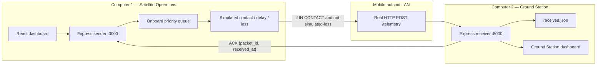

# Satellite Reliability AI

Physics-informed degradation prediction, remaining useful life (RUL) estimation, autonomous health management, and a **satellite-to-ground communication simulator**.

This repository is a **software prototype**. It does **not** talk to a physical satellite, and the software agent does **not** control the ESP32 hardware subsystem. The ESP32 (if used) runs independently.

## What is real vs simulated

| Piece | Reality |
| --- | --- |
| React operations dashboard (Computer 1) | Real application |
| Ground Station receiver API and dashboard (Computer 2) | Real HTTP service on the LAN / mobile hotspot |
| Telemetry JSON POST and acknowledgments | Real network transfer between the two computers |
| Persistent reception history | Real (JSON files under `data/ground-station/`) |
| PINN / RUL values placed in packets | Model predictions from the existing software (labeled `MODEL_PREDICTION`) |
| Dashboard hardware telemetry | Simulated unless you mark origin `MEASURED` in the existing console |
| NOAA GOES flux (when the live API works) | External observation (`EXTERNAL_OBSERVATION`) |
| Contact windows (IN CONTACT / OUT OF CONTACT) | **Simulated** — not orbital geometry |
| Transmission delay | **Simulated** — not RF propagation or link budget |
| Packet loss | **Simulated** — a lost attempt is never POSTed |
| ESP32 sensors / load cutoff | Independent hardware prototype, **not** wired into this comms path |

## Architecture



Data flow:

1. The onboard computer (sender) builds a versioned JSON packet from the live RUL/telemetry snapshot.
2. If the simulated contact window is closed, the packet stays in the store-and-forward queue.
3. When contact is open, packets go CRITICAL → HIGH → ROUTINE, FIFO within the same priority.
4. Simulated loss skips the HTTP POST for that attempt. Simulated delay waits, then POSTs.
5. Computer 2 validates the packet, stores it, and returns an ACK with the same `packet_id`.
6. Computer 1 removes the packet from the queue only after a valid matching ACK.
7. A deterministic policy engine may *recommend* downlink priorities. It does not drive the transport loop.

## Requirements

- Node.js 20+ (or 22)
- Two computers on the same mobile hotspot (or one computer for local testing)
- Windows: allow inbound TCP 8000 on Computer 2 (see firewall section)

## Install (both computers)

```bash
npm install
```

Optional environment (see `.env.example`):

```
GS_HOST=192.168.x.x
GS_PORT=8000
GS_BIND=0.0.0.0
GS_CORS_ORIGINS=http://192.168.x.x:3000
```

Do not commit secrets. `GEMINI_API_KEY` is only for the existing optional agent commentary.

## Computer 2 — Ground Station receiver

1. Connect to the hotspot.
2. Find this computer’s IPv4 address:

```powershell
ipconfig
```

Use the adapter for the hotspot (often “Wireless LAN adapter”). Example: `192.168.137.42`.

3. Allow the receiver through Windows Firewall (Administrator PowerShell):

```powershell
netsh advfirewall firewall add rule name="Satellite GS 8000" dir=in action=allow protocol=TCP localport=8000
```

4. Start the receiver (binds `0.0.0.0:8000` so the hotspot NIC can accept packets):

```bash
npm run ground-station
```

5. Check health on Computer 2:

```powershell
curl http://127.0.0.1:8000/health
```

From Computer 1 (replace the IP):

```powershell
curl http://192.168.137.42:8000/health
```

Open the Ground Station UI: `http://127.0.0.1:8000` (defaults to the Ground Station view).

## Computer 1 — Satellite Operations dashboard

```bash
npm run dev
```

Open `http://127.0.0.1:3000`, then **Satellite Communication**.

Set **Ground Station host** to Computer 2’s IP and **port** `8000`. Click **Apply link settings**, then **Probe GS health**.

Generate routine or critical packets. Close the contact window to queue; open it to transmit.

## Demonstration scenarios

On the Satellite Communication page (Computer 1), with Computer 2’s receiver running:

- **A — Normal operations:** Open contact, generate routine telemetry, watch ACK on both dashboards.
- **B — Ground station unavailable:** Close contact, generate several packets, confirm they stay queued.
- **C — Critical alert:** Close contact, generate routine packets plus a critical alert, open contact — critical is sent first.
- **D — Packet loss and retry:** Set simulated loss (for example 50%) and a seed, generate a packet, watch failed attempts then ACK.
- **E — Lost ACK:** Arm lost-ACK once (or run Scenario E). Receiver stores the packet; sender retries; receiver returns a duplicate ACK and does not create a second record.
- **F — Reset:** Clears the onboard queue and counters. Received history on Computer 2 is kept unless you click **Clear history** on the Ground Station page.

## Tests

```bash
npm test
```

Coverage includes schema validation, priority/FIFO, closed-window queuing, open-window transmit, seeded loss, retry exhaustion, ACK validation, duplicates, lost-ACK recovery, receiver offline, invalid payloads, and HTTP end-to-end delivery.

### Manual two-computer check

1. Hotspot: both PCs connected; Computer 2 firewall allows 8000.
2. Computer 2: `npm run ground-station` then `curl http://127.0.0.1:8000/health`.
3. Computer 1: `npm run dev`, set GS host to Computer 2’s IP, probe health.
4. Open contact, send a critical alert.
5. Computer 2 table shows the same `packet_id`; Computer 1 log shows `Acknowledged …` with that ID.

## Troubleshooting

| Symptom | What to check |
| --- | --- |
| Connection refused | Computer 2 process not running; wrong IP; receiver not bound (`GS_BIND=0.0.0.0`); firewall blocking 8000 |
| Timeout | Different Wi-Fi networks; hotspot client isolation; delay slider set very high |
| CORS error in the Ground Station view on Computer 1 | Add Computer 1 origin to `GS_CORS_ORIGINS`, e.g. `http://192.168.x.x:3000` |
| Invalid ACK | Packet schema mismatch or truncated JSON; check Computer 2 terminal |
| Queued forever | Contact window still OUT OF CONTACT, or retries exhausted (shown as EXHAUSTED, not deleted) |
| Duplicate rows | Should not happen; duplicates increment `duplicate_count` on the existing record |

## Existing software features

Mission Console, PINN degradation, Newton–Raphson RUL, aerospace RAG, and the autonomous mitigation sequence are unchanged. Communication is an additional dashboard plus the Ground Station process.

## Scripts

```bash
npm install
npm run dev              # Computer 1 — dashboard + sender API :3000
npm run ground-station   # Computer 2 — receiver + GS UI :8000
npm test
npm run lint
```
